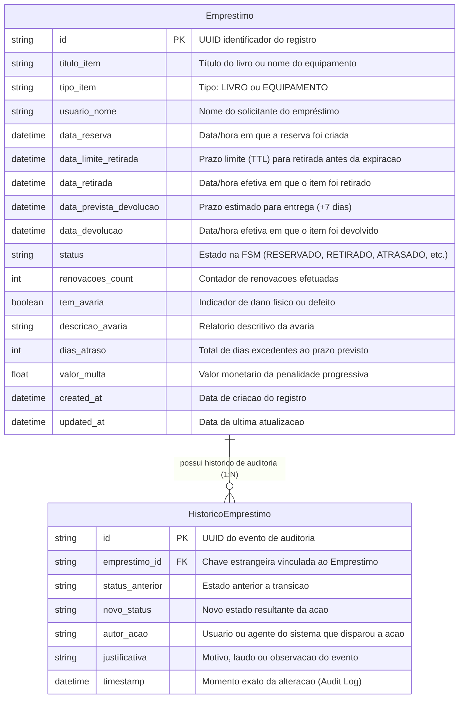
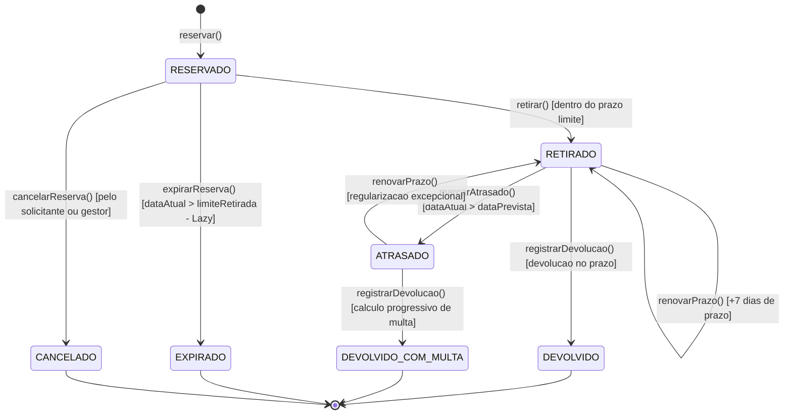

# 📚 Sistema de Controle de Empréstimo de Livros e Equipamentos Internos

> **Disciplina:** Programação Web II (PPW II)  
> **Tema 08:** Controle de Empréstimo de Livros / Equipamentos Internos  
> **Estudante:** Gabriel Soares Pedrosa (`bi3041271`)  
> **Repositório:** Atividade 3 (`atv3`) — Base evoluída a partir da `atv2`

---

## 🌟 Visão Geral do Projeto

Este projeto evolui a arquitetura desenvolvida na Atividade 2, transformando um modelo CRUD básico em um sistema corporativo completo, resiliente a concorrência e auditável. O sistema é regido por uma **Máquina de Estados Finita (FSM)** com transições orientadas a ações, persistência atômica via **transações ACID** do Prisma, **trilha de auditoria contínua (Audit Log)**, **cálculo progressivo de multas** com bloqueio preventivo de usuários e **expiração automática de reservas** baseada no padrão *Lazy Evaluation* (sem dependência exclusiva de cron jobs externos).

---

## 🏛️ Diagrama Entidade-Relacionamento (DER)



---

## 🔄 Diagrama de Estados da Máquina de Estados Finita (FSM)

Todas as alterações de status são orientadas a eventos semânticos com guardas de validação. Mutações diretas e arbitrárias de status são bloqueadas e retornam **HTTP 422 - Unprocessable Entity**.



---

## ⚡ Regras de Negócio de Alta Complexidade

### 1. Cálculo Progressivo de Multas e Bloqueio de Usuários (Tema 08)
* **Fórmula Progressiva (`CalculadoraMultaService`):**
  * Até 3 dias de atraso: **R$ 2,00** por dia.
  * De 4 a 7 dias de atraso: **R$ 3,50** por dia.
  * A partir do 8º dia: **R$ 5,00** por dia.
* **Bloqueio Preventivo:** Se um usuário possuir qualquer item com status `ATRASADO` (ou `RETIRADO` com prazo vencido), o sistema rejeita novas reservas com **HTTP 422**, impedindo o acúmulo de pendências.

### 2. Expiração de Reservas sem Cron Job Externo (Padrão Lazy Evaluation)
* Em vez de confiar em daemons ou timers em memória (`setInterval`) que falham se o servidor reiniciar ou escalar, o sistema implementa **Avaliação Preguiçosa (Just-In-Time Evaluation)**:
  * Toda vez que qualquer usuário lista empréstimos, consulta itens ou tenta reservar um novo recurso, o repositório executa na mesma transação atômica a expiração de reservas vencidas (`dataReserva + TTL < agora`).
  * O recurso é liberado imediatamente para o próximo solicitante.

### 3. Rastreabilidade e Auditoria ACID (Audit Log)
* Toda mudança de estado grava na tabela `HistoricoEmprestimo` de forma atômica (`$transaction` do Prisma).
* Se a gravação do log falhar por qualquer motivo, o status do empréstimo sofre rollback imediato.

---

## 🛠️ Tecnologias Utilizadas

* **Backend (`ppw_test_server`):**
  * Node.js & TypeScript
  * [NestJS](https://nestjs.com/) (Clean Architecture / Hexagonal)
  * [Prisma ORM](https://www.prisma.io/) com SQLite
* **Frontend (`ppw_test_client`):**
  * [Next.js 16](https://nextjs.org/) (App Router & Server Actions)
  * Tailwind CSS & Shadcn/Radix UI
  * TanStack Table
  * Lucide Icons

---

## 🚀 Como Executar o Projeto Localmente

### Pré-requisitos
* Node.js (v18+) e npm instalados.

### 1. Executando o Backend (Servidor NestJS)
```bash
# 1. Navegue até a pasta do servidor
cd ppw_test_server

# 2. Instale as dependências (se necessário)
npm install

# 3. Sincronize o banco de dados SQLite
npx prisma db push

# 4. Inicie o servidor em modo de desenvolvimento
npm run start:dev
```
* O backend estará disponível em: `http://localhost:8000`
* Endpoint de documentação e teste: `http://localhost:8000/emprestimos`

### 2. Executando o Frontend (Cliente Next.js)
```bash
# 1. Abra um novo terminal e navegue até a pasta do cliente
cd ppw_test_client

# 2. Instale as dependências (se necessário)
npm install

# 3. Inicie o servidor frontend
npm run dev
```
* O frontend estará disponível em: `http://localhost:3000` (ou `http://localhost:3000/emprestimos`)

---

## 📖 Documentação Adicional

* 📄 [`AI-LOG.md`](./AI-LOG.md) *(e espelho em [`docs/ai-decisions.md`](./docs/ai-decisions.md))*: Relatório formal do uso pedagógico e crítico da Inteligência Artificial.
* 🎓 [`docs/guia_estudo_oral.md`](./docs/guia_estudo_oral.md): Guia de estudos para defesa oral em laboratório (perguntas e respostas da banca + guia de alteração ao vivo).
* 📋 [`brain/plano_execucao.md`](./brain/plano_execucao.md): Histórico e planejamento das 5 fases de implementação.
