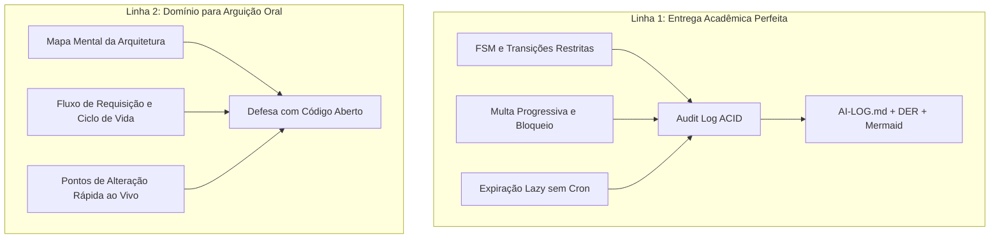

# 🧠 Guia de Atuação do Agente & Estratégia de Defesa - Atividade 3

> **Projeto:** 08 - Controle de Empréstimo de Livros / Equipamentos Internos  
> **Aluno:** Gabriel Soares Pedrosa (`bi3041271`)  
> **Disciplina:** Programação Web II (PPW II)  
> **Base de Origem:** `atv2` (NestJS Clean Architecture + Next.js + Prisma/SQLite)

---

## 🎯 Visão Geral & As Duas Linhas de Atuação

Neste projeto atuamos simultaneamente em duas frentes complementares:

---

## 🌿 Regra Crítica: Estratégia Obrigatória de Múltiplas Branches (Git)

> [!CAUTION]
> **Aviso do Professor:** Repositórios entregues com apenas uma branch (`main`/`master`) serão **desconsiderados**. A progressão do trabalho deve ser comprovada no histórico de branches e merges.

### Árvore de Branches Planejada:
1. `main`: Código consolidado, documentado e testado para entrega final.
2. `feature/fsm-maquina-estados`: 
   - Modelagem de estados, Value Objects (`StatusEmprestimo`), guardas de transição e bloqueio de `PUT` arbitrário.
3. `feature/audit-log-acid`: 
   - Criação da tabela/entidade `HistoricoEmprestimo` e persistência atômica via `$transaction` do Prisma.
4. `feature/multas-expiracao-lazy`: 
   - Regra de cálculo progressivo de multas, suspensão do usuário e expiração de reserva sob demanda (lazy evaluation).
5. `feature/interface-feedback`: 
   - Atualização do client Next.js com botões para ações de transição e feedback visual de status/auditoria.
6. `docs/relatorio-ai-e-readme`: 
   - README com DER + diagramas Mermaid e o arquivo obrigatório `AI-LOG.md`.

---

## 🏛️ Linha 1: Entrega Acadêmica Perfeita (O que o Professor Avalia)

### 1. Arquitetura e Modelagem de Dados (30 pts)
* **Normalização e Integridade:**
  * Entidade principal: `Emprestimo`.
  * Rastreabilidade vinculada: `HistoricoEmprestimo` (`id`, `emprestimoId`, `statusAnterior`, `novoStatus`, `usuarioId/autor`, `justificativa`, `timestamp`).
  * Controle de sanções/bloqueios de usuários com atraso.
* **Transações ACID:**
  * Toda transição crítica (reserva, retirada, devolução com multa, expiração) executada via `$transaction` do Prisma.
* **Máquina de Estados Finita (FSM) Desacoplada:**
  * Estados válidos e permitidos:
    * `RESERVADO` ➔ `RETIRADO` (ação: `retirar()`)
    * `RESERVADO` ➔ `EXPIRADO` (ação: `expirarReserva()`)
    * `RESERVADO` ➔ `CANCELADO` (ação: `cancelarReserva()`)
    * `RETIRADO` ➔ `DEVOLVIDO` (ação: `devolver()`)
    * `RETIRADO` ➔ `ATRASADO` (ação: `marcarAtrasado()`)
    * `ATRASADO` ➔ `DEVOLVIDO_COM_MULTA` (ação: `devolverComMulta()`)
  * Transições inválidas disparam HTTP 422 - `Unprocessable Entity`.

### 2. Regras de Negócio de Alta Complexidade (25 pts)
* **Cálculo Progressivo de Multas / Bloqueio por Dias de Atraso:**
  * Fórmula de penalidade progressiva parametrizada.
  * Regra de bloqueio do usuário: impedimento de novas reservas enquanto houver pendências ativas.
* **Lista de Reserva com Expiração Automática (Lazy Expiration):**
  * Padrão *Just-In-Time Evaluation*: avalia atomicamente reservas vencidas sem depender de cron job externo.

### 3. Registro do Uso Crítico da IA - `AI-LOG.md` (15 pts)
* Como os conceitos de FSM, concorrência e auditoria vieram dos **textos complementares** (e não foram lecionados em sala), registraremos formalmente:
  1. **O Desafio Teórico/Prático:** O que o texto complementar exigiu e como aplicar na prática.
  2. **O Prompt Utilizado:** O prompt exato (incluindo a pergunta obrigatória: *"Qual o padrão para processar expiração de reserva sem depender exclusivamente de cron job externo?"*).
  3. **A Resposta Bruta da IA:** A solução inicial proposta.
  4. **A Crítica e Refatoração:** Apontar as falhas da IA (ex: propor polling ineficiente, ignorar concorrência, não usar transações ACID, mutação arbitrária de status) e como refatoramos.

---

## 🛡️ Linha 2: Domínio Técnico & Preparação para Defesa Oral (30 pts)

### Mapa de Navegação Rápida
* **Entidade de Domínio & FSM:** `ppw_test_server/src/module/emprestimos/domain/` (regras puras de transição).
* **Casos de Uso / Serviços:** `ppw_test_server/src/module/emprestimos/application/use-case/` (orquestração e transações ACID).
* **Persistência / Prisma:** `ppw_test_server/src/module/emprestimos/infrastructure/adapters/` (queries SQL).
* **Controller:** `ppw_test_server/src/module/emprestimos/presentation/` (endpoints semânticos).

### Respostas-Chave para a Bancada
* *"Por que não usar PUT direto?"* ➔ *"Porque viola as regras de domínio. A FSM garante que cada mudança seja um evento auditado com validação de pré-condições."*
* *"Como funciona sem cron externo?"* ➔ *"Lazy evaluation atômica no banco: ao consultar ou alocar o recurso, o sistema expira registros vencidos na mesma transação ACID."*
* *"Onde fica a taxa da multa?"* ➔ *"Em um arquivo de constante/Value Object isolado de domínio, alterável em segundos."*

---

## 💬 Convenção de Interação no Chat

Para facilitar sua rotina, adotamos o seguinte formato de comando:

* `[FLUXO 1]` ou `[PROJETO]`: Foco em código, commits, branches e preenchimento dos requisitos acadêmicos (`AI-LOG.md`).
* `[FLUXO 2]` ou `[ESTUDO]`: Foco na sua preparação para a defesa oral, explicação de fluxo, queries e simulação de perguntas da banca.
* **Sem tag (padrão):** O agente executa a tarefa técnica do **Fluxo 1** e, ao final da resposta, adiciona um bloco curto **"🎓 Para a Defesa Oral (Fluxo 2)"** destacando o que você precisa saber daquela alteração.
