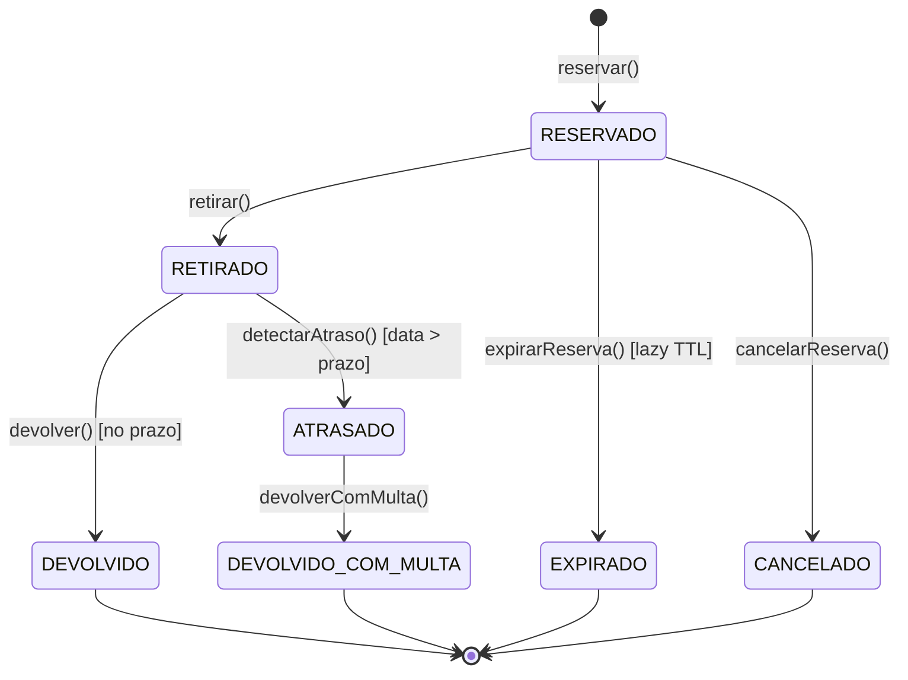

# 📋 Plano de Execução - Atividade 3: Controle de Empréstimo de Livros e Equipamentos

> **Tema:** 08 - Controle de Empréstimo de Livros / Equipamentos Internos  
> **Aluno:** Gabriel Soares Pedrosa (`bi3041271`)  
> **Critérios da Rubrica:** Arquitetura/DB (30 pts), Regras de Negócio/Exceções (25 pts), Relatório de IA (15 pts), Arguição Oral (30 pts)  
> **Regra Crítica de Entrega:** Uso obrigatório de múltiplas branches Git com histórico progressivo.

---

## 🗺️ Visão Geral das Fases & Branches

```mermaid
flowchart LR
    A[main: Base Inicial atv2] --> B[feature/fsm-maquina-estados]
    B -->|Merge| M1[main]
    M1 --> C[feature/audit-log-acid]
    C -->|Merge| M2[main]
    M2 --> D[feature/multas-expiracao-lazy]
    D -->|Merge| M3[main]
    M3 --> E[feature/interface-feedback]
    E -->|Merge| M4[main]
    M4 --> F[docs/relatorio-ai-e-readme]
    F -->|Merge Final| G[main: Versão Final Pronta]
```

---

## 📌 Fase 1: Máquina de Estados Finita (FSM) & Transições Restritas
**Branch:** `feature/fsm-maquina-estados`

### Objetivos:
1. Eliminar qualquer mutação arbitrária de status via formulário ou `PUT` genérico.
2. Definir a Máquina de Estados Finita no domínio com guardas de transição e exceções semânticas.
3. Criar endpoints orientados a eventos/ações no Controller.

### Diagrama de Estados da FSM:

### Tarefas Técnicas:
- [ ] Criar Value Object `StatusEmprestimo` com matriz de transições válidas e mensagens de erro descritivas (HTTP 422).
- [ ] Refatorar a entidade de domínio `Emprestimo` com métodos semânticos:
  - `retirar()`
  - `devolver()`
  - `cancelarReserva()`
  - `marcarAtrasado()`
- [ ] Remover endpoint genérico de atualização de status do `EmprestimosController`.
- [ ] Criar use cases específicos para cada ação de transição.
- [ ] Registrar **Entrada 1 no `AI-LOG.md`**: Desafio da transição restrita vs. mutação arbitrária de CRUD, prompt, resposta ingênua da IA e refatoração com guardas de domínio.
- [ ] Commit atômico na branch e merge na `main`.

---

## 📌 Fase 2: Rastreabilidade & Trilha de Auditoria (Audit Log com ACID)
**Branch:** `feature/audit-log-acid`

### Objetivos:
1. Garantir que nenhuma alteração de estado sobrescreva dados sem histórico completo.
2. Implementar persistência atômica via transação de banco de dados (`$transaction` do Prisma).

### Tarefas Técnicas:
- [ ] Atualizar o `prisma/schema.prisma` com o modelo `HistoricoEmprestimo`:
  - `id`, `emprestimoId`, `statusAnterior`, `novoStatus`, `usuarioId`, `justificativa`, `timestamp`.
  - Configurar Foreign Key com `Emprestimo`.
- [ ] Rodar migração/push do Prisma para atualizar o SQLite.
- [ ] Atualizar o repositório Prisma (`emprestimo.prisma.write.repository.ts`) para que toda transição grave o histórico na mesma transação atômica (`prisma.$transaction`).
- [ ] Registrar **Entrada 2 no `AI-LOG.md`**: Desafio de concorrência e auditoria ACID, prompt, resposta da IA sugerindo inserts avulsos sem rollback e refatoração garantindo atomicidade.
- [ ] Commit atômico na branch e merge na `main`.

---

## 📌 Fase 3: Regras de Alta Complexidade do Tema 08
**Branch:** `feature/multas-expiracao-lazy`

### Objetivos:
1. Cálculo progressivo de multas e bloqueio de usuários com pendências.
2. Fila de reservas com expiração automática inteligente (Lazy Evaluation sem depender exclusivamente de cron job).

### Tarefas Técnicas:
- [ ] Implementar o serviço/calculadora de domínio para **Multa Progressiva**:
  - Fórmula: valor base por dia + fator incremental por gravidade do atraso.
  - Regra de bloqueio do usuário para novos empréstimos enquanto houver atraso ou multa não liquidada.
- [ ] Implementar o padrão **Lazy Expiration (Just-In-Time Evaluation)**:
  - Ao listar, consultar ou tentar reservar um item, o sistema avalia atomicamente reservas vencidas (`dataReserva + TTL < agora`) e as transiciona para `EXPIRADO` dentro de uma transação.
- [ ] Registrar **Entrada 3 no `AI-LOG.md`** (Provocação obrigatória da tabela do professor):
  - *"Qual o padrão para processar expiração de reserva sem depender exclusivamente de cron job externo?"*
  - Resposta da IA (propondo `setInterval` frágil em memória) e nossa refatoração para Lazy Evaluation atômica.
- [ ] Commit atômico na branch e merge na `main`.

---

## 📌 Fase 4: Interface do Usuário & Feedback (Next.js)
**Branch:** `feature/interface-feedback`

### Objetivos:
1. Adaptar a UI do Next.js para refletir os botões de ação semântica e impedir ações inválidas no client.
2. Exibir modal/painel com a trilha de auditoria e cálculo de multas.

### Tarefas Técnicas:
- [ ] Atualizar componentes da tabela de empréstimos com botões de ação contextual (Retirar, Devolver, Cancelar).
- [ ] Criar visualizador de histórico/auditoria (Timeline das mudanças de estado).
- [ ] Exibir mensagens amigáveis para erros de domínio (HTTP 422 - ex: "Não é possível devolver item reservado").
- [ ] Exibir alertas de bloqueio de usuário ou valor de multa calculada no momento da devolução.
- [ ] Commit atômico na branch e merge na `main`.

---

## 📌 Fase 5: Documentação Técnica & Preparação para Arguição Oral
**Branch:** `docs/relatorio-ai-e-readme`

### Objetivos:
1. Finalizar `README.md` completo com DER, Diagrama Mermaid e guia de execução.
2. Consolidar o arquivo `AI-LOG.md` com todas as provocações, respostas e refatorações.
3. Gerar a "Cola de Domínio" (Flashcards para a Defesa Oral).

### Tarefas Técnicas:
- [ ] Gerar Diagrama Entidade-Relacionamento (DER) em Mermaid.
- [ ] Documentar instruções de inicialização rápida (`npm run dev` para client e server).
- [ ] Revisar e validar o `AI-LOG.md` com os 5 casos documentados.
- [ ] Merge final de todas as branches na `main`.
- [ ] Teste end-to-end do fluxo completo.
