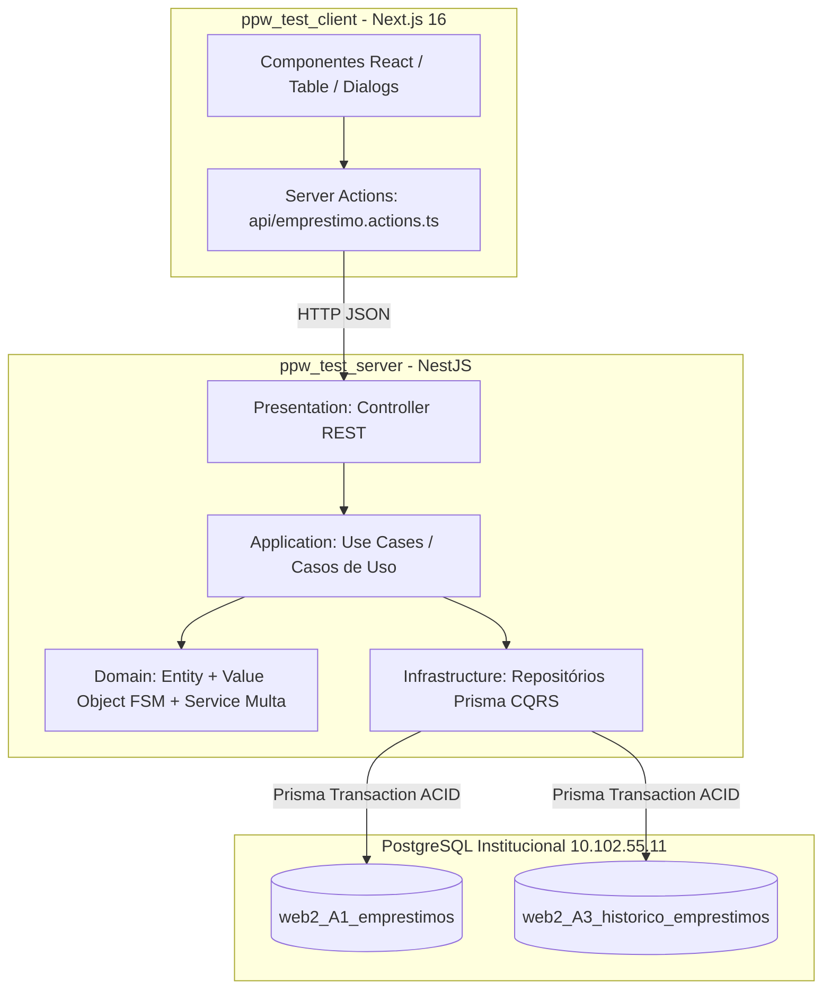

# 🗺️ Guia de Arquitetura & Mapa Completo de Pastas e Arquivos

> **Projeto:** 08 - Controle de Empréstimo de Livros e Equipamentos Internos  
> **Estudante:** Gabriel Soares Pedrosa (`bi3041271`)  
> **Disciplina:** Programação Web II (PPW II) — Atividade 3  
> **Objetivo deste Documento:** Explicar detalhadamente a função real de cada pasta e de cada arquivo do sistema, mostrando como eles se conectam e como os dados fluem do clique na tela até o banco PostgreSQL.

---

## 🏛️ 1. Visão Geral da Arquitetura do Sistema

O projeto adota os princípios de **Clean Architecture (Arquitetura Limpa)**, **Domain-Driven Design (DDD)** e separação **CQRS (Command Query Responsibility Segregation)**:

### O Princípio Fundamental: A Regra de Dependência
As camadas mais externas conhecem as internas, mas **o Domínio não conhece ninguém**:
- O **Domínio** não sabe o que é NestJS, não sabe o que é Prisma e não sabe o que é Next.js. Ele contém apenas as regras de negócio puras em TypeScript.
- A camada de **Aplicação (Use Cases)** orquestra as regras do domínio e declara *Portas (Interfaces)* para o banco.
- A camada de **Infraestrutura** implementa essas portas usando Prisma e PostgreSQL.
- A camada de **Apresentação (Controller)** apenas recebe requisições HTTP e entrega respostas em JSON.

---

## 📂 2. Backend (`ppw_test_server/`) — Estrutura e Papel dos Arquivos

O servidor NestJS é dividido estritamente em camadas. Abaixo está a função de cada arquivo:

### 2.1. Raiz do Backend e Configurações
- `ppw_test_server/src/main.ts`:  
  **O que faz:** Ponto de entrada (bootstrap) da aplicação NestJS. Inicializa o servidor HTTP na porta 3000 (ou configurada no `.env`), ativa o `ValidationPipe` global (que valida os DTOs com `class-validator`) e habilita CORS para o Next.js se comunicar.
- `ppw_test_server/src/app.module.ts`:  
  **O que faz:** O módulo raiz da aplicação. Importa os submódulos do sistema (`EmprestimosModule`, `PrismaService`, etc.).
- `ppw_test_server/src/infra/database/prisma.service.ts`:  
  **O que faz:** Serviço singleton do NestJS que estende o `PrismaClient`. Gerencia o ciclo de vida da conexão com o PostgreSQL (`onModuleInit` para conectar e `onModuleDestroy` para desconectar com segurança).
- `ppw_test_server/prisma/schema.prisma`:  
  **O que faz:** O contrato do banco de dados relacional. Define a URL de conexão do PostgreSQL (`DATABASE_URL`), os modelos das tabelas (`web2_A1_emprestimos` e `web2_A3_historico_emprestimos`) e preserva as tabelas de outros trabalhos do estudante (`tickets`).
- `ppw_test_server/prisma/seed.ts`:  
  **O que faz:** Script de dados de demonstração. Popula o banco remoto com 6 cenários realistas de teste cobrindo todos os estados da FSM (Reserva ativa, Empréstimo em andamento, Atrasado com cálculo de multa, Devolvido, etc.). Roda com `npm run seed`.

---

### 2.2. Camada de Domínio (`src/module/emprestimos/domain/`)
*Esta é a camada mais importante do projeto. Nela residem as regras de negócio puras.*

- `entity/emprestimo.entity.ts`:  
  **O que faz:** A Entidade de Negócio principal. Representa um empréstimo ou reserva em memória com todos os seus atributos (`id`, `tituloItem`, `usuarioNome`, `status`, `dataPrevistaDevolucao`, etc.).  
  **Sua função chave:** Contém os métodos que disparam eventos de negócio: `registrarRetirada()`, `registrarDevolucao()`, `renovarEmprestimo()`, `cancelarReserva()`. Ela impede mutação arbitrária de dados.
- `value-objects/status-emprestimo.value-object.ts`:  
  **O que faz:** Implementa a **Máquina de Estados Finita (FSM)**. Contém o enum `StatusEmprestimoEnum` e a matriz imutável `TRANSICOES_VALIDAS_FSM`.  
  **Sua função chave:** O método `validarTransicaoPara(novoStatus)`. Se a transição for proibida pela FSM (ex: de `RESERVADO` direto para `DEVOLVIDO`), ele barra e dispara a exceção.
- `services/calculadora-multa.service.ts`:  
  **O que faz:** Serviço de Domínio (Domain Service) puro. Calcula o valor financeiro da multa progressiva por faixas de dias de atraso (R$ 2,00/dia até 3 dias, R$ 3,50/dia de 4 a 7 dias, R$ 5,00/dia para 8+ dias) e adiciona taxa fixa de R$ 50 se o item sofrer avaria física.
- `exceptions/transicao-invalida.exception.ts`:  
  **O que faz:** A exceção semântica disparada quando alguém tenta violar a FSM. Retorna o status **HTTP 422 (Unprocessable Entity)** com payload detalhado informando qual era o status atual, o que tentaram fazer e quais eram os únicos caminhos permitidos.

---

### 2.3. Camada de Aplicação (`src/module/emprestimos/application/`)
*Orquestra os casos de uso, recebendo dados do mundo externo e chamando o Domínio.*

#### Casos de Uso (`use-case/`):
- `create-emprestimo.use-case.ts`: Executa a criação de uma nova reserva/empréstimo. Verifica antes se o usuário possui bloqueios por atraso ativo.
- `retirar-emprestimo.use-case.ts`: Executa o evento de retirada do item pelo usuário (`RESERVADO` ➔ `RETIRADO`).
- `devolver-emprestimo.use-case.ts`: Executa a devolução do item (`RETIRADO` ou `ATRASADO` ➔ `DEVOLVIDO` ou `DEVOLVIDO_COM_MULTA`), calculando multas e avarias.
- `renovar-emprestimo.use-case.ts`: Estende a data prevista de devolução em +7 dias e incrementa o contador `renovacoesCount`.
- `cancelar-emprestimo.use-case.ts`: Cancela uma reserva antes de ela ser retirada (`RESERVADO` ➔ `CANCELADO`).
- `get-all-emprestimo.use-case.ts`: Busca todos os empréstimos (disparando a expiração preguiçosa de reservas vencidas).
- `get-by-id-emprestimo.use-case.ts`: Busca um empréstimo específico pelo UUID.
- `get-historico-emprestimo.use-case.ts`: Busca a linha do tempo cronológica da trilha de auditoria daquele empréstimo.
- `update-emprestimo.use-case.ts`: Atualiza dados cadastrais (título, tipo, usuário) sem tocar no status de negócio.
- `delete-emprestimo.use-case.ts`: Exclui um registro do banco de dados (exclusão física administrativa).

#### DTOs & Portas (`dto/` e `ports/`):
- `dto/create-emprestimo.dto.ts`: Valida os dados de entrada para criação usando decorators (`@IsNotEmpty`, `@IsString`).
- `dto/update-emprestimo.dto.ts`: Valida dados parciais para edição cadastral.
- `dto/devolver-emprestimo.dto.ts`: Valida o payload de devolução (`temAvaria`, `descricaoAvaria`, `motivo`).
- `ports/emprestimo.repository.interface.ts`: As **Interfaces (Portas)** que definem os contratos do repositório de leitura (`IEmprestimoReadRepository`) e de escrita (`IEmprestimoWriteRepository`). Permite desacoplar totalmente o Use Case do Prisma.

---

### 2.4. Camada de Infraestrutura (`src/module/emprestimos/infrastructure/`)
*Comunica-se com o mundo externo (banco de dados PostgreSQL via Prisma).*

- `adapters/emprestimo.prisma.write.repository.ts`:  
  **O que faz:** O Repositório de Escrita (Commands). Implementa `IEmprestimoWriteRepository`.  
  **Sua função chave:**  
  1. Executa as mutações de status sempre sob **`this.prisma.$transaction` atômica**, garantindo que o status só atualize se o log de auditoria for gravado simultaneamente (ACID).  
  2. Implementa o *Lazy Evaluation* (`expirarReservasVencidas`) que expira reservas vencidas sob demanda no banco.  
  3. Implementa `verificarBloqueioUsuario` que impede novas reservas se houver itens atrasados.
- `adapters/emprestimo.prisma.read.repository.ts`:  
  **O que faz:** O Repositório de Leitura (Queries). Otimizado para consultas rápidas (`findAll`, `findById`, `findHistorico`) sem overhead de domínio.
- `mappers/emprestimo.prisma.mapper.ts`:  
  **O que faz:** Tradutor bidirecional. Converte o registro plano do Prisma/SQL (`PrismaEmprestimo`) para a Entidade rica de Domínio (`Emprestimo`), e vice-versa.

---

### 2.5. Camada de Apresentação (`src/module/emprestimos/presentation/`)
- `emprestimos.controller.ts`:  
  **O que faz:** O Controller REST HTTP. Expõe as rotas semânticas da API para o frontend:
  - `GET /emprestimos` ➔ Lista todos
  - `POST /emprestimos` ➔ Cria reserva
  - `POST /emprestimos/:id/retirar` ➔ Ação semântica de retirada
  - `POST /emprestimos/:id/devolver` ➔ Ação semântica de devolução
  - `POST /emprestimos/:id/renovar` ➔ Ação semântica de renovação
  - `POST /emprestimos/:id/cancelar` ➔ Ação semântica de cancelamento
  - `GET /emprestimos/:id/historico` ➔ Retorna trilha de auditoria
  - `PUT /emprestimos/:id` ➔ Edição cadastral
  - `DELETE /emprestimos/:id` ➔ Exclusão
- `emprestimos.module.ts`:  
  **O que faz:** Módulo NestJS que amarra Use Cases, Repositórios, Mappers e Controllers através de injeção de dependência.

---

## 💻 3. Frontend (`ppw_test_client/`) — Estrutura e Papel dos Arquivos

O cliente é construído com **Next.js 16 (App Router)**, Tailwind CSS, Radix UI e TanStack Table.

### 3.1. Roteamento e Telas (`src/app/`)
- `src/app/emprestimos/page.tsx`:  
  **O que faz:** A página principal do sistema. É um **Server Component** assíncrono que busca a lista inicial de empréstimos diretamente do backend (`getAllEmprestimos()`) e entrega renderizada ao navegador, carregando o componente interativo `EmprestimosTable`.
- `src/app/page.tsx`:  
  **O que faz:** Página inicial de boas-vindas com botão de navegação direta para o módulo de empréstimos.
- `src/app/layout.tsx`:  
  **O que faz:** Layout raiz da aplicação. Carrega as fontes Geist, estilos globais e envolve a aplicação.
- `src/app/globals.css`:  
  **O que faz:** Configurações base do Tailwind CSS v4 e variáveis de tema de cores (tokens de design).

---

### 3.2. Módulo de Empréstimos (`src/features/emprestimos/`)
*Agrupa toda a lógica de negócio, tipos, chamadas de API e telas do módulo.*

- `api/emprestimo.actions.ts`:  
  **O que faz:** **Server Actions** do Next.js. Funções assíncronas (`retirarEmprestimo`, `devolverEmprestimo`, `renovarEmprestimo`, `cancelarEmprestimo`, `getAllEmprestimos`, etc.) que executam no lado do servidor Next.js e chamam a API REST do NestJS via `fetch`.  
  **Sua função chave:** Captura os erros semânticos **HTTP 422** do backend e retorna `{ success: false, message: '...' }` para a interface exibir o banner de bloqueio.
- `type/emprestimo.type.ts`:  
  **O que faz:** Contratos de interface TypeScript para o frontend (`Emprestimo`, `HistoricoItem`, `CreateEmprestimoInput`), garantindo tipagem forte entre os componentes.

#### Componentes de Interface (`components/`):
- `EmprestimosTable.tsx`:  
  **O que faz:** O componente mestre da tela. Gerencia o estado da tabela, campo de busca com debounce, abas de filtro rápido (*Todos*, *Reservados*, *Em Aberto*, *Atrasados*, *Finalizados*), cards de métricas no topo e orquestra a abertura de todos os modais (Dialogs).
- `emprestimos-columns.tsx`:  
  **O que faz:** A definição das colunas para a biblioteca TanStack Table. Define como cada célula é desenhada:
  - Célula 1: Item & Solicitante juntos com ícone.
  - Célula 2: Badge estilizado do estado na FSM.
  - Célula 3: Prazos, tags de renovação e multas acumuladas.
  - Célula 4: Ações contextuais (botões de Retirar/Devolver/Renovar na barra + menu dropdown `...`).
- `emprestimos.module.css`:  
  **O que faz:** Módulo CSS exclusivo da tabela de empréstimos. Define `table-layout: fixed; width: 100%` e larguras percentuais exatas (31%, 18%, 23%, 28%), **garantindo ZERO scroll horizontal** e eliminando poluição de classes inline.
- `EmprestimoHistoricoDialog.tsx`:  
  **O que faz:** Modal que exibe a **Trilha de Auditoria (Audit Log ACID)**. Mostra uma timeline vertical estilizada com cada transição de estado, quem realizou, a justificativa e a data formatada.
- `emprestimoDevolverDialog.tsx`:  
  **O que faz:** Modal de confirmação de devolução. Permite ao operador registrar laudo de avaria física se o equipamento/livro foi devolvido quebrado.
- `emprestimoFormDialog.tsx`:  
  **O que faz:** Modal com formulário reativo (`react-hook-form` + `zod`) para cadastrar nova reserva ou editar dados de um item existente.
- `emprestimoDeleteDialog.tsx`:  
  **O que faz:** Modal de confirmação para exclusão física de registros com botão destrutivo em vermelho.

---

### 3.3. Componentes de UI Base (`src/components/ui/`)
Componentes visuais reutilizáveis baseados em **Radix UI**:
- `dropdown-menu.tsx`: Menu suspenso flutuante acessível para as ações secundárias (*Editar* e *Excluir*).
- `dialog.tsx`: Primitivos de modais com foco travado e backdrop translúcido.
- `button.tsx`: Botões com variantes de estilo (`default`, `outline`, `destructive`, `ghost`).
- `badge.tsx`: Etiquetas de status coloridas.
- `table.tsx`: Primitivos HTML de tabela com bordas limpas.
- `alert.tsx`: Banners para feedback de sucesso ou erros de regra de negócio (HTTP 422).

---

## 📚 4. Documentação e Planejamento (`docs/` e Raiz)

- `AI-LOG.md` (e `docs/ai-decisions.md`):  
  **O que faz:** O diário de bordo exigido pelo professor. Narra a jornada em primeira pessoa, mostrando seus questionamentos, resumos didáticos e como você corrigiu as propostas iniciais do agente.
- `docs/guia_estudo_oral.md`:  
  **O que faz:** O roteiro de preparação para a arguição oral com o professor. Contém o *Pitch de 60 segundos*, o simulador de perguntas de banca (Q&A) e o *Cheat Sheet* para alterar valores de multa e prazos ao vivo.
- `docs/pesquisas/`:  
  **O que contém:** Os 4 resumos conceituais gerados antes da codificação (`01-fsm-maquina-estados.md`, `02-audit-log-rastreabilidade.md`, `03-concorrencia-expiracao-lazy.md`, `04-multas-progressivas-bloqueio.md`).
- `docs/planos/`:  
  **O que contém:** O plano geral (`plano-geral-atv3.md`) e os 6 planos de ação específicos de cada etapa do projeto.
- `README.md`:  
  **O que faz:** Visão geral da arquitetura, diagramas em Mermaid (FSM e DER), variáveis de ambiente e instruções para rodar o backend e frontend.
- `atv3.code-workspace`:  
  **O que faz:** Arquivo de espaço de trabalho do VS Code que ensina o editor a reconhecer o backend e o frontend como projetos integrados, eliminando qualquer sublinhado vermelho no editor.

---

## 🔄 5. O Ciclo de Vida de uma Requisição (Exemplo Prático: "Devolver Livro")

Se o professor perguntar: *"Gabriel, me explica o caminho que a informação faz quando eu clico no botão Devolver"*, responda com esta sequência:

1. **Interface (Next.js):** O usuário clica em `Devolver` na tabela [`EmprestimosTable.tsx`](/atvs%20avaliativas/atv3/ppw_test_client/src/features/emprestimos/components/EmprestimosTable.tsx). Abre o modal [`emprestimoDevolverDialog.tsx`](/atvs%20avaliativas/atv3/ppw_test_client/src/features/emprestimos/components/emprestimoDevolverDialog.tsx) e ele confirma.
2. **Server Action:** O modal chama a action `devolverEmprestimo(id, payload)` em [`emprestimo.actions.ts`](/atvs%20avaliativas/atv3/ppw_test_client/src/features/emprestimos/api/emprestimo.actions.ts), que faz um `POST /emprestimos/:id/devolver` no servidor NestJS.
3. **Controller:** O [`emprestimos.controller.ts`](/atvs%20avaliativas/atv3/ppw_test_server/src/module/emprestimos/presentation/emprestimos.controller.ts) recebe a chamada HTTP, valida o DTO e encaminha para o caso de uso.
4. **Use Case:** O [`devolver-emprestimo.use-case.ts`](/atvs%20avaliativas/atv3/ppw_test_server/src/module/emprestimos/application/use-case/devolver-emprestimo.use-case.ts) busca a entidade no repositório e chama o método de domínio `emprestimo.registrarDevolucao()`.
5. **Domínio (FSM):** A Entidade consulta o Value Object [`status-emprestimo.value-object.ts`](/atvs%20avaliativas/atv3/ppw_test_server/src/module/emprestimos/domain/value-objects/status-emprestimo.value-object.ts).  
   - Se o livro estiver `RESERVADO`: a FSM bloqueia imediatamente e dispara `TransicaoInvalidaException` (HTTP 422).  
   - Se estiver `RETIRADO` ou `ATRASADO`: a FSM aprova e calcula a multa via [`calculadora-multa.service.ts`](/atvs%20avaliativas/atv3/ppw_test_server/src/module/emprestimos/domain/services/calculadora-multa.service.ts).
6. **Repositório (Transação ACID):** O [`emprestimo.prisma.write.repository.ts`](/atvs%20avaliativas/atv3/ppw_test_server/src/module/emprestimos/infrastructure/adapters/emprestimo.prisma.write.repository.ts) abre `this.prisma.$transaction` e atualiza a tabela `web2_A1_emprestimos` e insere o histórico em `web2_A3_historico_emprestimos` atomicamente no PostgreSQL.
7. **Retorno:** A Controller devolve o JSON com sucesso, a Server Action entrega para o React e o alerta verde de sucesso aparece na tela, recarregando a tabela instantaneamente.
