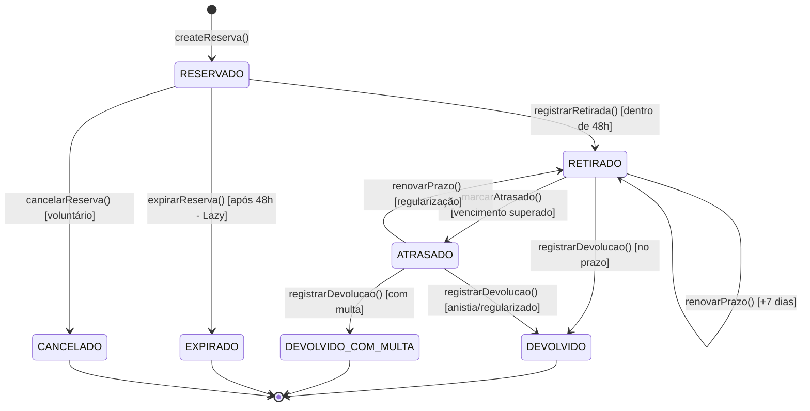

# 📋 Plano 02: Modelagem da Máquina de Estados Finita (FSM) no Domínio

> **Módulo:** Camada de Domínio & Regras de Negócio (DDD)  
> **Líder Técnico:** Gabriel Soares Pedrosa (`bi3041271`)  
> **Branch Git:** `feature/fsm-maquina-estados`  
> **Status:** Concluído e Validado  
> **Dependência:** Etapa 01 (`feature/database-postgres`)

---

## 🎯 1. Contexto & Diagnóstico da Base Herdada

Na Atividade 2, a mutação de estado ocorria via requisição `PUT /emprestimos/:id`:
- O cliente frontend enviava um payload JSON livre, por exemplo: `{ "status": "DEVOLVIDO" }`.
- O backend aceitava essa alteração diretamente no banco de dados sem verificar se o item já havia sido retirado fisicamente, se a reserva estava expirada ou se o item já tinha sido devolvido anteriormente.
- Esse comportamento caracteriza um **Modelo Anêmico de Domínio** (*Anemic Domain Model*), onde o banco é apenas um depósito de dados e as regras de negócio ficam dispersas ou ausentes.

### O Mandato da Atividade 3:
Substituir o modelo anêmico por um **Modelo Rico de Domínio** fundamentado em uma **Máquina de Estados Finita (FSM - Finite State Machine)** estrita, onde apenas transições válidas são aceitas e tentativas ilegais geram respostas semânticas **HTTP 422 Unprocessable Entity**.

---

## 📐 2. Especificação da Máquina de Estados Finita (FSM)

### Estados Possíveis do Ciclo de Vida:
1. `RESERVADO`: Estado inicial após o agendamento da reserva pelo solicitante (TTL de 48h).
2. `RETIRADO`: Item retirado fisicamente pelo usuário; prazo de devolução fixado em 7 dias.
3. `ATRASADO`: Prazo de devolução venceu e o item ainda não foi devolvido ao acervo.
4. `DEVOLVIDO`: Item entregue no prazo sem penalidades (Estado Terminal).
5. `DEVOLVIDO_COM_MULTA`: Item entregue fora do prazo com cálculo de multa progressiva (Estado Terminal).
6. `EXPIRADO`: Reserva cancelada automaticamente por ultrapassar 48h sem retirada física (Estado Terminal).
7. `CANCELADO`: Reserva cancelada voluntariamente pelo usuário antes da retirada (Estado Terminal).

### Matriz de Adjacência de Transições Válidas (`TRANSICOES_VALIDAS_FSM`):



### Contrato TypeScript da Matriz de Transições:
```typescript
export const TRANSICOES_VALIDAS_FSM: Record<StatusEmprestimoEnum, StatusEmprestimoEnum[]> = {
  [StatusEmprestimoEnum.RESERVADO]: [
    StatusEmprestimoEnum.RETIRADO,
    StatusEmprestimoEnum.EXPIRADO,
    StatusEmprestimoEnum.CANCELADO,
  ],
  [StatusEmprestimoEnum.RETIRADO]: [
    StatusEmprestimoEnum.DEVOLVIDO,
    StatusEmprestimoEnum.ATRASADO,
  ],
  [StatusEmprestimoEnum.ATRASADO]: [
    StatusEmprestimoEnum.DEVOLVIDO_COM_MULTA,
    StatusEmprestimoEnum.DEVOLVIDO,
    StatusEmprestimoEnum.RETIRADO,
  ],
  [StatusEmprestimoEnum.DEVOLVIDO]: [],           // Terminal
  [StatusEmprestimoEnum.DEVOLVIDO_COM_MULTA]: [], // Terminal
  [StatusEmprestimoEnum.EXPIRADO]: [],            // Terminal
  [StatusEmprestimoEnum.CANCELADO]: [],           // Terminal
};
```

---

## 💬 3. Diálogo de Alinhamento Técnico & Decisão de Arquitetura

> **Proposta Inicial da IA:**  
> *"Podemos manter o endpoint `PUT /emprestimos/:id` e adicionar um bloco de validação com vários `if` e `else` dentro da classe `EmprestimosController`. Se o status não for válido, lançamos um `BadRequestException` (HTTP 400)."*

> **Intervenção Técnica de Gabriel Soares:**  
> *"Mas peraí, se a gente colocar esse monte de `if` na Controller, não vai bagunçar a Controller inteira e violar exatamente o que o professor explicou sobre manter a regra de negócio isolada no Domínio? Além disso, erro 400 não é pra erro de sintaxe do JSON? Quando o JSON tá bem formatado mas a regra de negócio não permite a transição, não tem um status HTTP mais correto, tipo 422? Como a gente modela isso direto no Domínio usando DDD?"*

> **Análise & Ajuste:**  
> 1. **Encapsulamento no Domínio:** Remover a validação de status da Controller. Toda a lógica de transição foi migrada para o Value Object `StatusEmprestimo` e para a entidade `EmprestimoEntity`.
> 2. **Semântica HTTP 422 (Unprocessable Entity):** Criar a classe `TransicaoInvalidaException` herdando de `HttpException(HttpStatus.UNPROCESSABLE_ENTITY)`.
> 3. **Rotas Semânticas REST:** Criar endpoints expressivos na Controller:
>    - `POST /emprestimos/:id/retirar`
>    - `POST /emprestimos/:id/devolver`
>    - `POST /emprestimos/:id/renovar`
>    - `POST /emprestimos/:id/cancelar`
> 4. O endpoint `PUT /emprestimos/:id` foi restrito exclusivamente a atualizações cadastrais (ex: alterar descrição ou nome digitado errado), lançando erro caso o empréstimo já esteja em estado terminal.

---

## 📋 4. Passo a Passo de Execução

1. **Criação do Value Object (`StatusEmprestimo`):**
   - Arquivo: `src/module/emprestimos/domain/value-objects/status-emprestimo.value-object.ts`.
   - Implementa o encapsulamento do enum primitivo, validação de criação e método `validarTransicaoPara(proximoStatus)`.

2. **Criação da Exceção Semântica (`TransicaoInvalidaException`):**
   - Arquivo: `src/module/emprestimos/domain/exceptions/transicao-invalida.exception.ts`.
   - Gera um payload estruturado para o frontend:
     ```json
     {
       "statusCode": 422,
       "error": "Unprocessable Entity - Violação de FSM",
       "message": "Transição de estado inválida: Não é permitido alterar de 'RESERVADO' para 'DEVOLVIDO'. Estados permitidos: [RETIRADO, EXPIRADO, CANCELADO].",
       "statusAtual": "RESERVADO",
       "statusDestinoTentado": "DEVOLVIDO",
       "estadosPermitidos": ["RETIRADO", "EXPIRADO", "CANCELADO"]
     }
     ```

3. **Refatoração da Entidade de Domínio (`EmprestimoEntity`):**
   - Arquivo: `src/module/emprestimos/domain/entity/emprestimo.entity.ts`.
   - Métodos ricos de ciclo de vida:
     - `createReserva()`: Factory method com TTL de 48h.
     - `registrarRetirada()`: Valida TTL e projeta devolução em +7 dias.
     - `renovarPrazo()`: Adiciona +7 dias se estiver RETIRADO ou ATRASADO.
     - `registrarDevolucao()`: Executa vistoria física e dispara cálculo de multa.
     - `cancelarReserva()`: Cancela reservas pendentes.

4. **Atualização da Controller REST (`EmprestimosController`):**
   - Mapeamento das rotas semânticas POST e PATCH para compatibilidade.

---

## 🧪 5. Plano de Testes & Casos de Borda

| Caso de Teste | Ação Executada | Resposta Esperada | Validação |
| :--- | :--- | :--- | :---: |
| **CT-01: Fluxo Feliz Regular** | Reserva ➔ Retirada ➔ Devolução | Status 200 OK em cada etapa; status final `DEVOLVIDO`. | Aprovado |
| **CT-02: Salto Ilegal (Pulo de Estado)** | Tentar devolver direto uma reserva (`RESERVADO` ➔ `DEVOLVIDO`) | **HTTP 422 Unprocessable Entity** com lista de permitidos. | Aprovado |
| **CT-03: Violação de Estado Terminal** | Tentar retirar um empréstimo já devolvido (`DEVOLVIDO` ➔ `RETIRADO`) | **HTTP 422 Unprocessable Entity** indicando que é estado terminal. | Aprovado |
| **CT-04: Renovação Concedida** | Renovar empréstimo com status `RETIRADO` | Prazo estendido em 7 dias, contador `renovacoesCount = 1`. | Aprovado |
| **CT-05: Edição Cadastral em Estado Terminal** | Executar `PUT /emprestimos/:id` em item devolvido | Erro de domínio impedindo alteração de registro fechado. | Aprovado |

---

## ⚠️ 6. Riscos & Mitigações
- **Risco:** Clientes HTTP antigos ou scripts legados enviando requisições genéricas `PUT` ou `PATCH`.  
  *Mitigação:* A controller foi mantida com aliases para `PATCH /emprestimos/:id/retirar`, etc., e o `PUT` foi transformado em endpoint estritamente cadastral, sem quebrar retrocompatibilidade.
