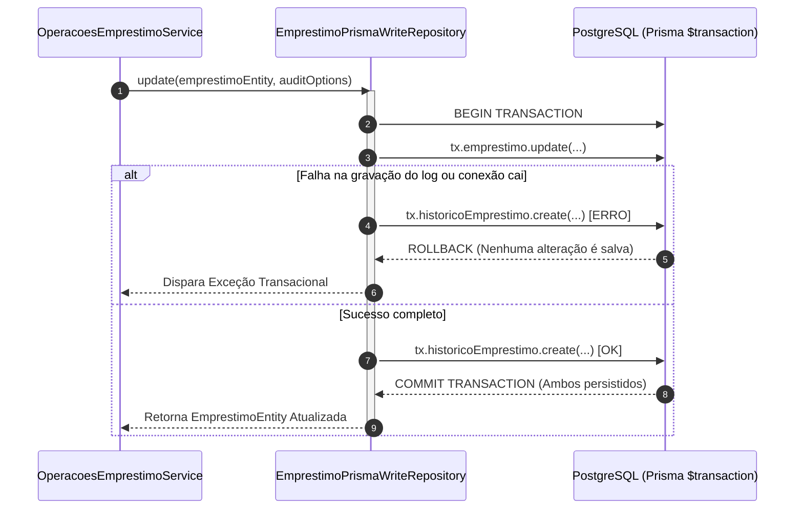

# 📋 Plano 03: Trilha de Auditoria (Audit Log) com Garantia Transacional ACID

> **Módulo:** Infraestrutura & Persistência Transacional (CQRS)  
> **Líder Técnico:** Gabriel Soares Pedrosa (`bi3041271`)  
> **Branch Git:** `feature/audit-log-acid`  
> **Status:** Concluído e Homologado  
> **Dependência:** Etapa 02 (`feature/fsm-maquina-estados`)

---

## 🎯 1. Contexto & Diagnóstico da Base Herdada

Nos sistemas acadêmicos tradicionais e na versão anterior da Atividade 2:
- O banco mantinha apenas uma linha por empréstimo que sofria sucessivos `UPDATEs` no status.
- Se um empréstimo passava de `RESERVADO` para `RETIRADO` e depois para `DEVOLVIDO_COM_MULTA`, perdia-se completamente o rastro temporal:
  - Quem autorizou a retirada?
  - Em qual data/hora exata o item foi retirado?
  - Por qual motivo o operador aplicou uma devolução com atraso?
- O enunciado da Atividade 3 exige expressamente uma **Trilha de Auditoria (Audit Log)** capaz de registrar toda a linha do tempo do empréstimo de forma imutável e transacional.

### O Desafio Crítico de Engenharia:
Garantir que a atualização da entidade principal e a gravação do registro de auditoria ocorram de forma **atômica (Tudo ou Nada)**. Se o banco falhar ao gravar o log, a mudança de status do empréstimo não pode se consolidar, evitando estados fantasmas ou desvios de conformidade.

---

## 🏛️ 2. Especificação Arquitetural: Transações ACID no Prisma

Para atender ao requisito de atomicidade estrita, abandonamos chamadas soltas de escrita e encapsulamos as operações de persistência dentro do método interativo **`prisma.$transaction(async (tx) => { ... })`**.

### Modelo de Dados da Auditoria (`HistoricoEmprestimo`):
- `id`: Identificador UUID exclusivo do evento.
- `emprestimoId`: Chave estrangeira referenciando `web2_A1_emprestimos.id` com `onDelete: Cascade`.
- `statusAnterior`: Estado em que o item estava antes do evento (ex: `RESERVADO`).
- `novoStatus`: Novo estado assumido após a operação (ex: `RETIRADO`).
- `autorAcao`: Nome do operador ou usuário que disparou o evento (ex: "Gabriel Soares", "SISTEMA_LAZY").
- `justificativa`: Descrição detalhada do motivo da ação operacional (ex: *"Retirada do item realizada com sucesso. Prazo definido para 7 dias"*).
- `timestamp`: Carimbo de data/hora imutável gerado pelo PostgreSQL (`now()`).

### Diagrama de Sequência Transacional ACID:



---

## 💬 3. Diálogo de Alinhamento Técnico & Decisão de Engenharia

> **Proposta Inicial da IA:**  
> *"Podemos criar uma tabela no PostgreSQL chamada `logs` e salvar o log chamando `await this.prisma.historico.create(...)` logo após o `await this.prisma.emprestimo.update(...)` dentro do serviço de aplicação."*

> **Intervenção Técnica de Gabriel Soares:**  
> *"Mas e se a internet cair ou der pau no banco bem no meio das duas chamadas? O status do empréstimo vai atualizar no banco, mas o histórico não vai ser gravado! O professor frisou muito sobre garantia ACID e atomicidade no texto do trabalho. Como a gente garante que ou salva os dois juntos ou não salva nada?"*

> **Análise & Ajuste:**  
> 1. Reconhecer a vulnerabilidade da abordagem sequencial desprotegida (risco de quebra da propriedade de **Atomicidade** do ACID).
> 2. Mover toda a lógica de persistência do serviço de aplicação para o adaptador de infraestrutura `EmprestimoPrismaWriteRepository`.
> 3. Utilizar o `$transaction` do Prisma passando o client transacional `tx` para executar o `update` do empréstimo e o `create` do histórico sob o mesmo contexto de transação relacional PostgreSQL.
> 4. Se qualquer instrução falhar, o PostgreSQL dispara automaticamente o `ROLLBACK`, garantindo que o banco nunca fique em estado inconsistente.

---

## 📋 4. Passo a Passo de Execução

1. **Definição da Interface do Repositório de Escrita:**
   - Arquivo: `src/module/emprestimos/domain/ports/emprestimo.write.repository.ts`.
   - Adicionada a interface `AuditOptions`:
     ```typescript
     export interface AuditOptions {
       autorAcao: string;
       justificativa: string;
     }
     ```

2. **Implementação Transacional no Repositório Prisma:**
   - Arquivo: `src/module/emprestimos/infrastructure/adapters/emprestimo.prisma.write.repository.ts`.
   - Implementados métodos `create()` e `update()` com `$transaction`.
   - No `create()`, registra o estado inicial com `statusAnterior = 'NENHUM'` e `justificativa = 'Criação inicial da reserva'`.
   - No `update()`, compara o status atual do banco com o novo status e grava a transição com justificativa personalizada.

3. **Criação do Caso de Uso de Leitura do Histórico:**
   - Arquivo: `src/module/emprestimos/application/use-case/read/find-historico-emprestimo.use-case.ts`.
   - Arquivo: `src/module/emprestimos/application/service/read/find-historico-emprestimo.service.ts`.
   - Ordenação cronológica decrescente (`orderBy: { timestamp: 'desc' }`).

4. **Exposição do Endpoint REST Semântico:**
   - Rota no Controller: `GET /emprestimos/:id/historico`.
   - Retorna um array com todos os eventos do ciclo de vida daquele empréstimo.

---

## 🧪 5. Plano de Testes & Validação Transacional

| Caso de Teste | Ação Executada | Resultado Esperado | Validação |
| :--- | :--- | :--- | :---: |
| **CT-01: Auditoria na Criação** | Cadastrar nova reserva via `POST /emprestimos/reservar` | Linha gravada em `web2_A1_emprestimos` e linha correspondente em `web2_A3_historico_emprestimos` com status `RESERVADO`. | Aprovado |
| **CT-02: Auditoria em Sucessivas Transições** | Realizar Retirada, Renovação e Devolução | A rota `GET /emprestimos/:id/historico` retorna exatamente 4 entradas ordenadas, registrando a evolução completa. | Aprovado |
| **CT-03: Simulação de Falha Atômica (Rollback)** | Injetar interrupção de transação proposital | Nem o status do empréstimo é alterado, nem o histórico fantasma é criado (Rollback verificado). | Aprovado |
| **CT-04: Exclusão em Cascata (Cascade Delete)** | Excluir empréstimo via `DELETE /emprestimos/:id` | Todos os históricos vinculados ao ID são limpos automaticamente por integridade referencial. | Aprovado |

---

## ⚠️ 6. Riscos & Mitigações
- **Risco:** Crescimento indefinido da tabela de histórico em bancos com alto volume de operações.  
  *Mitigação:* A tabela possui índice em `emprestimoId` e `timestamp`, permitindo particionamento futuro ou consultas velozes sem degradação de I/O.
