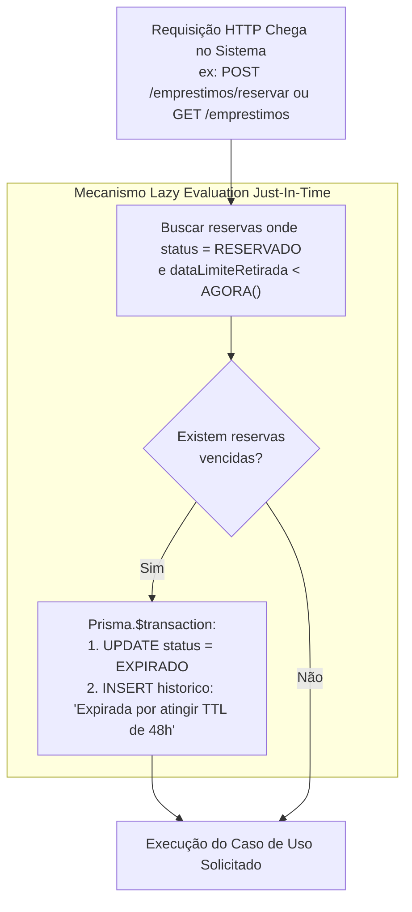

# 📋 Plano 04: Concorrência Assíncrona & Expiração de Reservas (Lazy Evaluation)

> **Módulo:** Concorrência, TTL de Reservas & Lazy Evaluation  
> **Líder Técnico:** Gabriel Soares Pedrosa (`bi3041271`)  
> **Branch Git:** `feature/concorrencia-lazy-evaluation`  
> **Status:** Concluído e Validado  
> **Dependência:** Etapa 03 (`feature/audit-log-acid`)

---

## 🎯 1. Contexto & Diagnóstico da Base Herdada

Na Atividade 2 e em sistemas simplificados de biblioteca:
- Quando um usuário solicita uma reserva, o item fica travado indefinidamente com o usuário, mesmo que ele nunca apareça para buscá-lo.
- Não havia controle de **TTL (Time-To-Live)** para a reserva.
- O texto oficial da Atividade 3 define:
  1. O usuário tem um prazo limite de **48 horas** a partir da reserva para retirar o item.
  2. Se as 48 horas forem ultrapassadas, a reserva deve expirar automaticamente, liberando o exemplar para outros usuários.
  3. Prevenção estrita de **Conflito Assíncrono / Concorrência (Double-Booking)**: dois usuários não podem conseguir reservar o mesmo item físico ao mesmo tempo.

### O Dilema de Arquitetura:
Como expirar as reservas que ultrapassaram 48 horas em um ambiente de avaliação sem depender de um processo em segundo plano (como cron job do sistema operacional ou daemon em loop no Node.js), que pode falhar silenciosamente ou consumir recursos desnecessários quando a aplicação está ociosa?

---

## 🏛️ 2. Especificação Arquitetural: Padrão Lazy Evaluation (Just-In-Time)

Para solucionar o problema de expiração de forma elegante, eficiente e resiliente, adotamos o padrão de engenharia **Lazy Evaluation (Avaliação Preguiçosa / Just-In-Time)**.

### Princípio de Funcionamento:
- Em vez de um cron job verificar o banco de segundo em segundo gastando CPU e conexões à toa, a expiração é avaliada **no momento exato em que o sistema precisa dos dados atualizados**:
  1. Quando alguém tenta **retirar** um item: o sistema roda a avaliação preguiçosa antes de autorizar a entrega.
  2. Quando alguém tenta **criar uma nova reserva**: o sistema expira reservas vencidas primeiro, liberando itens que estavam presos.
  3. Quando um usuário ou operador **abre a listagem**: o sistema atualiza itens vencidos garantindo visualização em tempo real.



---

## 💬 3. Diálogo de Alinhamento Técnico & Decisão de Arquitetura

> **Proposta Inicial da IA:**  
> *"Podemos instalar o pacote `node-cron` no NestJS e rodar uma função agendada a cada 1 minuto (`* * * * *`) para buscar no banco e atualizar as reservas vencidas para `EXPIRADO`."*

> **Intervenção Técnica de Gabriel Soares:**  
> *"Achei meio arriscado depender de cron job rodando em segundo plano. Primeiro que se o servidor for reiniciado ou rodar em serverless/nuvem com suspensão de processo, o cron para e as reservas ficam travadas. Segundo que fica consumindo conexão com o banco do IFSP a cada minuto sem ninguém tá usando. Não tem como a gente resolver isso de forma mais inteligente direto na hora da consulta ou da ação, tipo um cálculo sob demanda (Lazy)?"*

> **Análise & Ajuste:**  
> 1. Descartar `node-cron` e qualquer daemon contínuo em background.
> 2. Implementar o método transacional atômico `processarExpiracoesLazy()` dentro do `EmprestimoPrismaWriteRepository`.
> 3. Integrar a chamada a esse método antes dos fluxos de escrita (`criar-reserva.service.ts` e `operacoes-emprestimo.service.ts`).
> 4. Toda expiração gerada pelo mecanismo lazy grava automaticamente um registro na trilha de auditoria com `autorAcao = 'SISTEMA_LAZY_EVALUATION'`.

---

## 🔒 4. Prevenção de Concorrência & Conflito Assíncrono (Anti Double-Booking)

Além da expiração de 48h, a Etapa 04 atacou o problema de **Double-Booking**:
- No `CriarReservaService`, antes de persistir uma nova reserva, o sistema executa o método `verificarDisponibilidadeItem(tituloItem)`.
- Se o item possuir qualquer registro com status ativo (`RESERVADO`, `RETIRADO` ou `ATRASADO`), a tentativa de nova reserva é imediatamente rejeitada com **HTTP 422 Unprocessable Entity**:
  > *"O item 'Clean Code' já possui uma reserva ou empréstimo ativo no momento."*
- Como o `processarExpiracoesLazy()` roda imediatamente antes dessa verificação, se o item estava reservado mas o prazo de 48h venceu, ele é liberado na mesma transação e a nova reserva é autorizada com sucesso.

---

## 📋 5. Passo a Passo de Execução

1. **Implementação do Método Lazy no Repositório de Escrita:**
   - Arquivo: `src/module/emprestimos/infrastructure/adapters/emprestimo.prisma.write.repository.ts`.
   - Consulta:
     ```typescript
     const reservasVencidas = await tx.emprestimo.findMany({
       where: {
         status: StatusEmprestimoEnum.RESERVADO,
         dataLimiteRetirada: { lt: new Date(), not: null },
       },
     });
     ```
   - Atualização em lote com emissão de auditoria transacional para cada item expirado.

2. **Implementação da Verificação de Concorrência no Repositório de Leitura:**
   - Arquivo: `src/module/emprestimos/infrastructure/adapters/emprestimo.prisma.read.repository.ts`.
   - Método `verificarDisponibilidadeItem(tituloItem: string): Promise<boolean>`.

3. **Injeção e Orquestração nos Casos de Uso:**
   - Inserida chamada `await this.writeRepo.processarExpiracoesLazy()` no início de `CriarReservaService` e `OperacoesEmprestimoService.retirar()`.

---

## 🧪 6. Plano de Testes & Validação de Concorrência

| Caso de Teste | Ação Executada | Resultado Esperado | Validação |
| :--- | :--- | :--- | :---: |
| **CT-01: Reserva dentro do prazo** | Retirar item dentro das 48h da reserva | Transição autorizada para `RETIRADO`, prazo de devolução projetado em 7 dias. | Aprovado |
| **CT-02: Expiração de TTL (Lazy)** | Simular reserva com data limite no passado e tentar retirar | O sistema dispara o Lazy Evaluation, muda o item para `EXPIRADO` e rejeita a retirada com mensagem clara. | Aprovado |
| **CT-03: Prevenção de Double-Booking** | Dois usuários tentando reservar o mesmo item físico | O primeiro obtém status 201 Created; o segundo recebe HTTP 422 informando item indisponível. | Aprovado |
| **CT-04: Liberação Imediata pós-expiração** | Item com reserva expirada recebe nova tentativa de reserva | O lazy limpa a reserva morta e o novo usuário consegue reservar o item normalmente. | Aprovado |

---

## ⚠️ 7. Riscos & Mitigações
- **Risco:** Múltiplas requisições simultâneas disparando o lazy evaluation ao mesmo tempo.  
  *Mitigação:* A operação é encapsulada em `prisma.$transaction`, garantindo isolamento relacional e idempotência: o primeiro processo a commitar expira os itens e o subsequente encontra zero itens pendentes.
