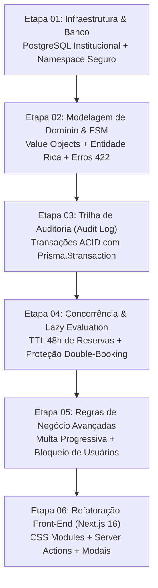

# 📋 Plano Geral de Engenharia & Arquitetura — Atividade 3 (`/plan`)

> **Projeto:** Sistema Corporativo de Controle de Empréstimos e Reservas de Livros e Equipamentos  
> **Tema Acadêmico:** Tema 08 — PPW II (4º Semestre)  
> **Líder Técnico & Desenvolvedor:** Gabriel Soares Pedrosa (`bi3041271`)  
> **Instituição:** IFSP — Programação Web II  
> **Status:** Concluído e Validado em Produção Local  
> **Repositório:** `https://github.com/Gabriel-Soaress/web2-atv3.git`  
> **Stack Tecnológica:** Next.js 16 (App Router, Server Actions, TanStack Table, CSS Modules) + NestJS (Clean Architecture, DDD, CQRS, Prisma ORM) + PostgreSQL Institucional Remoto (`10.102.55.11`)

---

## 🏛️ 1. Diagnóstico da Base Herdada (Atividade 2) & Motivação da Refatoração

Na **Atividade 2**, o sistema foi desenvolvido como uma prova de conceito básica (PoC):
1. **Modelo Anêmico de Domínio:** A entidade de empréstimo era apenas uma estrutura de dados de passagem com getters e setters (ou objeto anêmico), sem nenhuma validação intrínseca de negócio.
2. **Operações Arbitrárias via `PUT`:** Qualquer cliente HTTP podia alterar o status de um empréstimo para qualquer valor (ex: de `SOLICITADO` direto para `DEVOLVIDO`), violando o ciclo de vida físico de um empréstimo.
3. **Ausência de Trilha de Auditoria:** O banco armazenava apenas o estado atual (`snapshot`). Se um empréstimo mudava de status, não havia histórico de quem realizou a ação, data/hora ou justificativa.
4. **Acoplamento com Banco Local / SQLite:** A base original usava SQLite local em desenvolvimento e tabelas sem namespace, o que não atende às exigências de um ambiente corporativo com PostgreSQL multi-tenant institucional.
5. **UI sem Ergonomia Visual:** Tabela com excesso de colunas soltas que estourava a largura da tela gerando barras de rolagem horizontais desconfortáveis, além de falta de modais específicos para ações de negócio como devolução com vistoria e inspeção de histórico.

### O Mandato da Atividade 3:
Transformar esse CRUD simples em uma solução enterprise robusta que contemple:
- **Máquina de Estados Finita (FSM)** com transições orientadas a eventos e respostas semânticas HTTP 422.
- **Trilha de Auditoria (Audit Log) Imutável** com garantia estrita de transações ACID no PostgreSQL.
- **Resolução de Concorrência e TTL de 48h** através do padrão arquitetural **Lazy Evaluation (Just-In-Time)**.
- **Cálculo Progressivo de Multas & Bloqueio Preventivo** implementado em Domain Service puro.
- **Frontend Ergonômico de Alta Usabilidade** com Next.js 16, Server Actions tipadas e layout estrito sem barra de rolagem horizontal (*Zero Horizontal Scroll*).

---

## 🗺️ 2. Roadmap Executivo das Etapas de Implementação

O projeto foi decomposto em 6 etapas técnicas interdependentes, cada uma com seu plano detalhado de execução, branch isolada no Git e critérios de aceitação específicos:

### Índice de Planos Específicos

| # | Módulo Técnico | Arquivo de Especificação | Branch Git | Entregáveis Principais |
| :-: | :--- | :--- | :--- | :--- |
| **01** | **Migração da Base & Banco Remoto** | [`01-plano-migracao-banco.md`](01-plano-migracao-banco.md) | `feature/database-postgres` | Schema Prisma unificado, preservação da tabela `tickets`, namespace `web2_A1` e `web2_A3`. |
| **02** | **Máquina de Estados Finita (FSM)** | [`02-plano-fsm-dominio.md`](02-plano-fsm-dominio.md) | `feature/fsm-maquina-estados` | `StatusEmprestimo` VO, matriz imutável `TRANSICOES_VALIDAS_FSM`, `TransicaoInvalidaException` (422), rotas REST semânticas. |
| **03** | **Trilha de Auditoria (Audit Log ACID)** | [`03-plano-audit-log-acid.md`](03-plano-audit-log-acid.md) | `feature/audit-log-acid` | Tabela `web2_A3_historico_emprestimos`, atomicidade via `prisma.$transaction`, endpoint `GET /emprestimos/:id/historico`. |
| **04** | **Concorrência & Lazy Evaluation** | [`04-plano-expiracao-lazy.md`](04-plano-expiracao-lazy.md) | `feature/concorrencia-lazy-evaluation` | Método `processarExpiracoesLazy()`, expiração automática do TTL de 48h sem cron job externo, checagem anti double-booking. |
| **05** | **Multas Progressivas & Bloqueio** | [`05-plano-multas-bloqueio.md`](05-plano-multas-bloqueio.md) | `feature/multas-bloqueio` | `CalculadoraMultaService` (faixas 1-3 dias, 4-7 dias, 8+ dias), vistoria de avarias, método de bloqueio preventivo para novos empréstimos. |
| **06** | **UI/UX Refactor & CSS Modules** | [`06-plano-ui-refactor-css.md`](06-plano-ui-refactor-css.md) | `feature/ui-css-modules-refactor` | `emprestimos.module.css` (Zero Scroll), TanStack Table reativa, modais de Vistoria, Auditoria e Formulário com Server Actions. |

---

## 📐 3. Decisões Arquiteturais Globais (ADRs)

### ADR-01: Adoção de Clean Architecture com DDD e CQRS
- **Decisão:** Separar o backend em quatro camadas concêntricas: `domain` (entidades, value objects, domain services), `application` (use cases, DTOs e interfaces de repositórios), `infrastructure` (adaptadores Prisma e mappers) e `presentation` (controllers REST).
- **Justificativa:** Garantir que o núcleo do sistema (regras de empréstimo, multas e FSM) seja testável e 100% independente de frameworks, ORMs ou bibliotecas externas. A separação CQRS (`read.repository` e `write.repository`) otimiza consultas sem carregar lógica desnecessária de mutação.

### ADR-02: Transições de Estado Semânticas vs `PUT` Genérico
- **Decisão:** O endpoint genérico `PUT /emprestimos/:id` foi estritamente restrito à alteração de metadados cadastrais descritivos (como correção ortográfica do título ou nome). Qualquer alteração de status operacional deve ser acionada via rotas semânticas dedicadas (`POST /emprestimos/:id/retirar`, `/devolver`, `/renovar`, `/cancelar`).
- **Justificativa:** No mundo real, um livro não é "atualizado" para devolvido; ele passa por um evento de devolução que envolve vistoria, verificação de prazos, cálculo de multa e gravação de histórico imutável.

### ADR-03: Processamento de Expiração via Lazy Evaluation (Just-In-Time)
- **Decisão:** Em vez de depender de um scheduler em background (como `node-cron` ou daemon do SO) que consome CPU ociosa e introduz complexidade operacional e risco de travamento em servidores compartilhados, a detecção de reservas expiradas (TTL 48h) é disparada de forma preguiçosa nas operações de escrita e listagem.
- **Justificativa:** Garante consistência imediata dos dados exatamente no instante em que o sistema é consultado ou manipulado, utilizando transações ACID nativas do banco de dados.

---

## 🔒 4. Matriz de Rastreabilidade de Requisitos Avaliativos

| Requisito do Professor / Descrição da Atividade | Arquivos Implementados | Status |
| :--- | :--- | :---: |
| **1. Conexão com PostgreSQL institucional** | `prisma/schema.prisma`, `src/infra/database/prisma.service.ts` | Concluído |
| **2. FSM no Domínio & Erro 422 semântico** | `domain/value-objects/status-emprestimo.value-object.ts`, `domain/exceptions/transicao-invalida.exception.ts` | Concluído |
| **3. Trilha de Auditoria (Audit Log) com ACID** | `infrastructure/adapters/emprestimo.prisma.write.repository.ts`, tabela `web2_A3_historico_emprestimos` | Concluído |
| **4. Concorrência assíncrona & TTL 48h** | `write.repository.ts` (`processarExpiracoesLazy`), checagem anti double-booking | Concluído |
| **5. Multa progressiva & Bloqueio preventivo** | `domain/services/calculadora-multa.service.ts`, `read.repository.ts` (`verificarBloqueioUsuario`) | Concluído |
| **6. Front-end ergonômico sem scroll horizontal** | `features/emprestimos/components/EmprestimosTable.tsx`, `emprestimos.module.css` | Concluído |
| **7. Trilha de transparência da IA e Guia Oral** | `AI-LOG.md`, `docs/guia_estudo_oral.md`, `docs/mapa_arquitetura_e_arquivos.md` | Concluído |

---

## 🚀 5. Critérios Globais de Aceite (Definition of Done - DoD)
- [x] O build de produção do backend (`npm run build`) compila sem erros ou avisos de tipagem.
- [x] O build de produção do frontend (`npm run build`) compila com rotas estáticas e dinâmicas perfeitamente otimizadas.
- [x] Nenhuma tabela de outras disciplinas no schema `bi3041271` do PostgreSQL foi deletada ou alterada.
- [x] Tentativas de transições proibidas da FSM retornam status HTTP 422 com payload descritivo.
- [x] O design da tabela frontend permanece 100% contido na viewport (zero scroll horizontal em resoluções desktop normais).
- [x] O repositório Git contém commits limpos, rastreáveis e mensagens semânticas em português.
